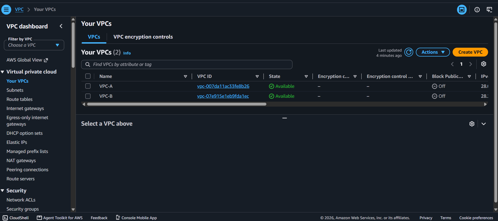
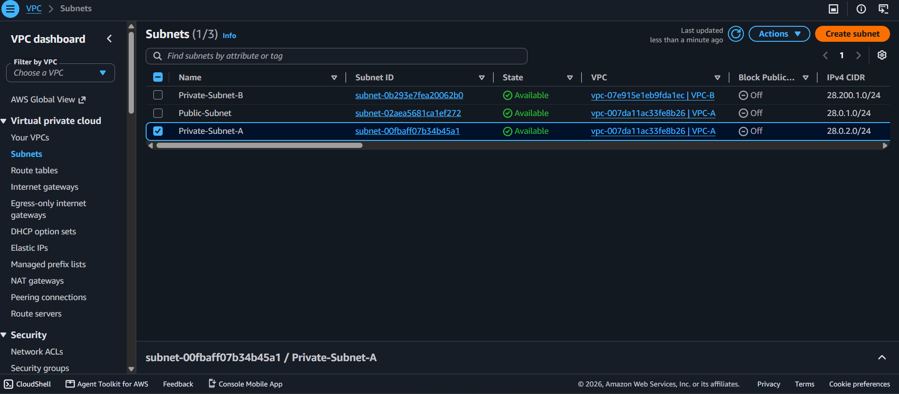
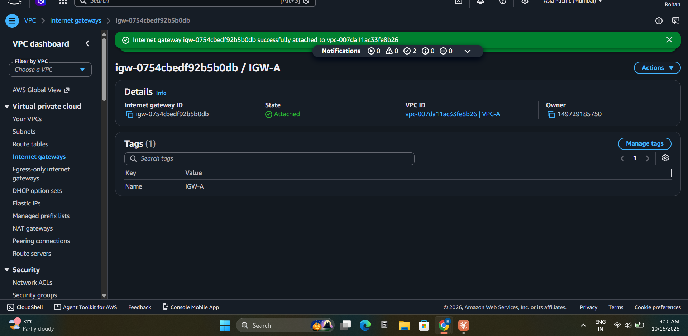
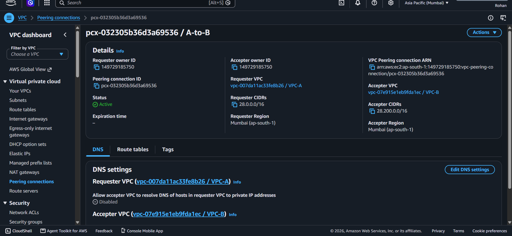
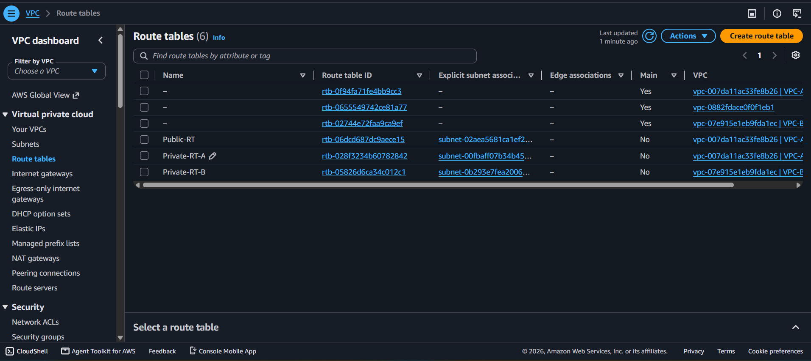
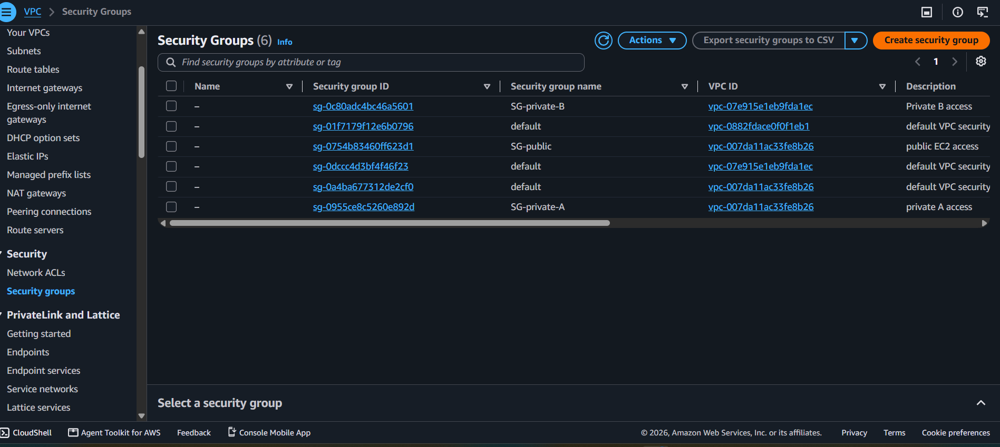
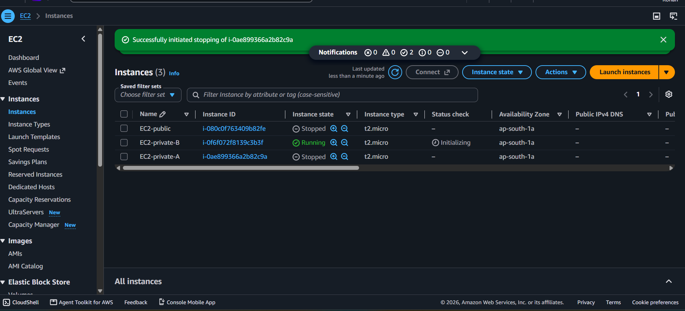
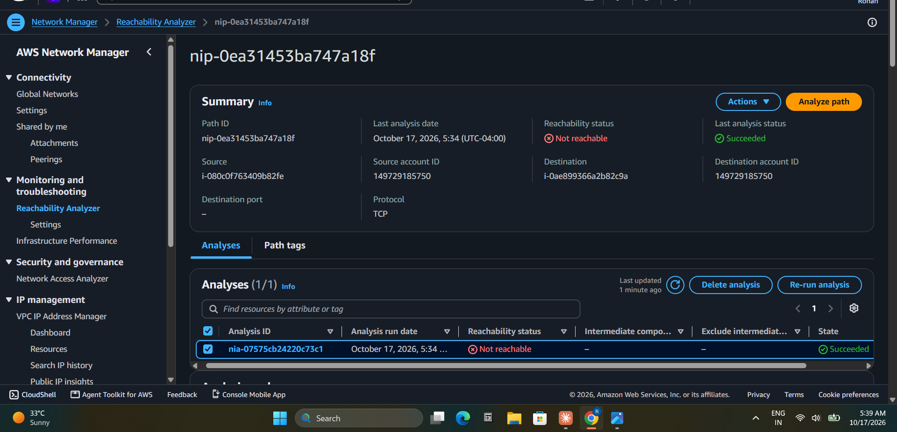
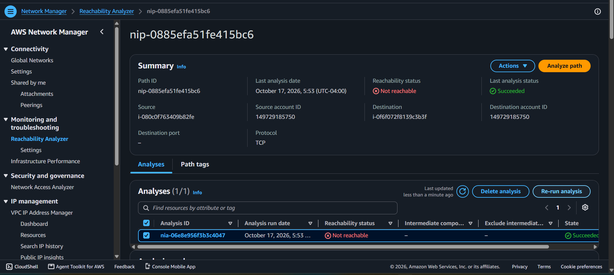

# AWS VPC Peering Project

Hands-on AWS networking project: two VPCs connected with VPC peering, with a public subnet, private subnets, an Internet Gateway and EC2 instances.

## Architecture

## Network Design
| Resource | Name | CIDR |
|---|---|---|
| VPC | VPC-A | 28.0.0.0/16 |
| Public Subnet | Public-Subnet | 28.0.1.0/24 |
| Private Subnet | Private-Subnet-A | 28.0.2.0/24 |
| VPC | VPC-B | 28.200.0.0/16 |
| Private Subnet | Private-Subnet-B | 28.200.1.0/24 |

Region: Asia Pacific (Mumbai) - ap-south-1

## Components
- 2 VPCs with non-overlapping CIDR blocks
- Internet Gateway (IGW-A) attached to VPC-A
- VPC Peering connection (A-to-B) between VPC-A and VPC-B
- 3 route tables: Public-RT, Private-RT-A, Private-RT-B
- 3 security groups: SG-public, SG-private-A, SG-private-B
- 3 EC2 instances (t2.micro): one public, two private

## Route Tables
| Route Table | Destination | Target |
|---|---|---|
| Public-RT | 0.0.0.0/0 | IGW-A |
| Public-RT | 28.200.0.0/16 | Peering (A-to-B) |
| Private-RT-A | 28.200.0.0/16 | Peering (A-to-B) |
| Private-RT-B | 28.0.0.0/16 | Peering (A-to-B) |

Peering needs a route on both sides. Without the return route, traffic goes out but replies never come back.

## Security Groups
| Security Group | VPC | Inbound |
|---|---|---|
| SG-public | VPC-A | SSH (22) from my IP, ICMP from both VPCs |
| SG-private-A | VPC-A | SSH (22) from 28.0.1.0/24, ICMP from both VPCs |
| SG-private-B | VPC-B | SSH (22) from 28.0.0.0/16, ICMP from 28.0.0.0/16 |

## Screenshots
### VPCs

### Subnets

### Internet Gateway

### Peering Connection (Active)

### Route Tables

### Security Groups

### EC2 Instances

### Connectivity Test: Public to Private-A

### Connectivity Test: Public to Private-B (via VPC Peering)

## How to Build (Summary)
1. Create VPC-A (28.0.0.0/16) and VPC-B (28.200.0.0/16)
2. Create the subnets in each VPC
3. Create IGW-A and attach it to VPC-A
4. Create the peering connection A-to-B and accept it
5. Create the route tables, add routes (including the peering routes on both sides) and associate subnets
6. Create the security groups
7. Launch the EC2 instances in the right subnets
8. Verify connectivity

## Connectivity Verification
The AWS account allowed only 1 running vCPU, so three instances could not run at the same time. Instead of a live ping test, connectivity was verified with AWS VPC Reachability Analyzer (TCP, port 22), which checks routes, peering and security groups.

## Troubleshooting
- **vCPU limit error:** EC2 launch failed with "vCPU limit of 1". Switched to t2.micro and created instances one at a time.
- **Reachability test returned Not reachable:** The destination port was left empty, so the analyzer checked all ports while the security group allowed only port 22. Setting port 22 fixed it.
- **Wrong subnet name:** The private subnet was named Public-Subnet-A by mistake. Fixed by editing the Name tag.

## What I Learned
- How VPCs, subnets and route tables work together
- Difference between public and private subnets
- VPC peering needs routes in both VPCs
- Security groups control SSH and ICMP traffic
- How to troubleshoot connectivity with Reachability Analyzer

## Cleanup
All AWS resources were deleted after testing to avoid charges.

## Author
Rohan Thaokar
